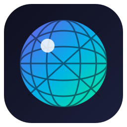

<p align="center">
  
</p>

# Disco Minimal++

**100% Rust ile sıfırdan yazılmış, minimal ve performans odaklı Minecraft launcher.**
A minimal, performance-first Minecraft launcher, written from scratch in 100% Rust.

[Disco Launcher](https://github.com/Discoheadmc/Disco-Launcher)'ın ruhunu — *"iyi bir launcher'ı iyi yapan şeyi koru, geri kalanını çıkar"* — çok daha hızlı bir tabana taşıyan yeni nesil proje. UI tabanı olarak [OneLauncher](https://github.com/Polyfrost/OneLauncher) ile aynı **Freya** (Polyfrost fork) motorunu, mimari ilham olarak aynı monorepo düzenini kullanır.

## Neden Rust?

| | Disco Launcher (Electron/XMCL) | Disco Minimal++ (Rust/Freya) |
|---|---|---|
| Bellek kullanımı | ~200-400 MB | hedef ~40-80 MB |
| Açılış süresi | saniyeler | hedef milisaniyeler |
| Telemetri | yok | yok (değişmez) |
| Tek binary | hayır | evet |

## Mimari

```
packages/
├── disco_common   # sabitler, veri dizinleri, ortak hata tipleri
├── disco_net      # HTTP istemcisi; SHA1 doğrulamalı, paralel indirme motoru
├── disco_auth     # çevrimdışı (Mojang-tarzı UUID) + Microsoft hesapları
├── disco_mc       # Mojang piston-meta manifest, sürüm çözümleme, dosya hazırlığı, komut üretimi
├── disco_core     # instance yönetimi, ayarlar, Java kurulumu, başlatma orkestrasyonu
├── disco_content  # Modrinth mağazası: arama, .mrpack kurulumu, Fabric/Quilt profilleri
└── disco_app      # Freya UI (disco_minimal++ binary'si)
```

## Durum — Kilometre Taşı 2

- [x] Cargo workspace altyapısı (edition 2024, Rust 1.97+)
- [x] Mojang sürüm manifesti: çekme + ayrıştırma + disk önbelleği (çevrimdışı açılış)
- [x] Sürüm çözümleme (`inheritsFrom` zinciri + custom sürümler)
- [x] Client jar + kütüphaneler + assetler için paralel, SHA1 doğrulamalı indirme
- [x] Natives çıkarma (LWJGL)
- [x] Instance modeli (dosya tabanlı, XMCL/Prism tarzı)
- [x] Çevrimdışı hesap (gerçek Mojang `OfflinePlayer:` UUID algoritması)
- [x] **Microsoft hesap girişi** (device code flow; XBL → XSTS → Minecraft services, otomatik token yenileme)
- [x] **Java otomatik indirme** (Mojang java-runtime API; sistem Java'sı yoksa gereken sürüm iner)
- [x] **8 renk tema seçici** (Disco Launcher geleneği, anında uygulanır)
- [x] **Modrinth mağazası** — mod paketi ara, popüler listesi, tek tıkla kurulum
- [x] **Fabric/Quilt loader** — mod paketleri için loader profili otomatik kurulur
- [x] `.mrpack` kurulum motoru (index ayrıştırma + overrides + paralel dosya indirme)
- [x] **GitHub Actions CI** — her push'ta kontrol/test/build; `v*` tag'lerinde NSIS installer + Release
- [x] **Windows installer** (cargo-packager + NSIS, EXE ikonu gömülü)
- [ ] Forge desteği
- [ ] Borderless özel başlık çubuğu
- [ ] CurseForge mağazası

## Geliştirme

**Gereksinimler:** Rust 1.97+ ([rustup](https://rustup.rs/)), Windows'ta MSVC Build Tools.

```bash
# Çalıştır
cargo run -p disco_app

# Release derle
cargo build -p disco_app --release

# Windows installer (NSIS) üret
cargo install cargo-packager --locked
cargo build --release -p disco_app
cargo packager --release -p disco_app --formats nsis
```

## Lisans

[GPL-3.0](LICENSE). Bu proje sıfırdan yazılmıştır; OneLauncher (GPL-3.0) ve Polyfrost Freya
fork'u mimari ve UI tabanı olarak referans alınmıştır, bu yüzden proje GPL-3.0 ile
lisanslanmıştır. Disco Launcher'ın (MIT) fikir mirası ayrı olarak yaşar.
